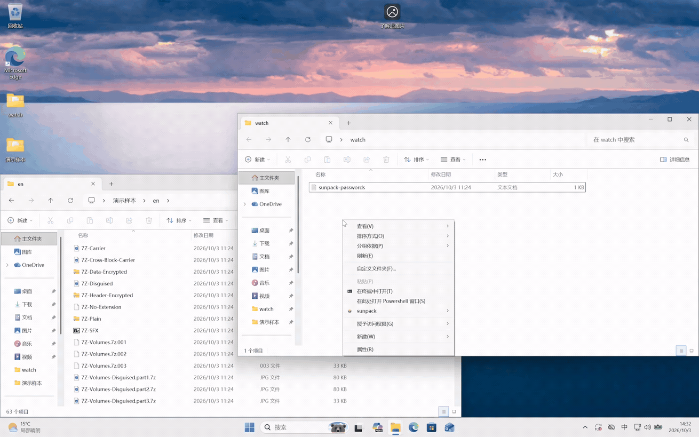
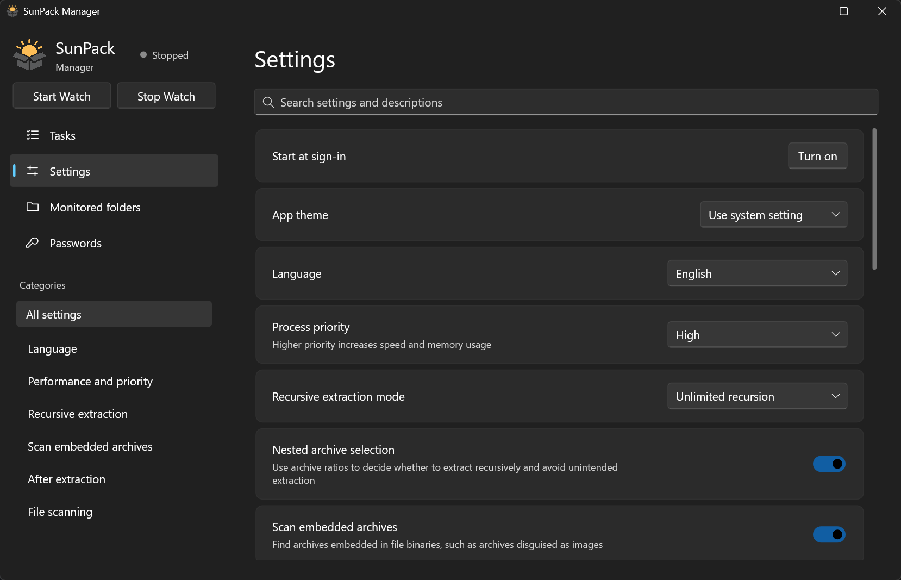

<p align="center"></p>
<h1 align="center">SunPack</h1>
<p align="center"><b>Windows 向けアーカイブ処理ツール。フォルダーを監視し、アーカイブをバックグラウンドで自動展開します。</b></p>

<p align="center"><a href="README.zh-CN.md">简体中文</a> · <a href="README.md">English</a> · <a href="README.zh-TW.md">繁體中文</a> · <b>日本語</b> · <a href="README.ko.md">한국어</a> · <a href="https://github.com/Qinjingxue/Sunpack/releases/latest">ダウンロード</a></p>

<p align="center">
  <a href="https://github.com/Qinjingxue/Sunpack/releases/latest"></a>
  
  <a href="docs/licensing.md"></a>
</p>

<p align="center"></p>

## 目次

- [インストール](#インストール)
- [使い方](#使い方)
  - [管理画面とパスワード](#管理画面とパスワード)
- [主な機能](#主な機能)
  - [アーカイブの識別](#アーカイブの識別)
  - [再帰処理](#再帰処理)
  - [後処理](#後処理)
  - [Watch 監視](#watch-監視)
  - [堅牢性と WAL による復旧](#堅牢性と-wal-による復旧)
  - [並行処理と速度の最適化](#並行処理と速度の最適化)
  - [アイドル時のリソース使用量](#アイドル時のリソース使用量)
- [設定](#設定)
- [開発とテスト](#開発とテスト)
  - [アーキテクチャの概要](#アーキテクチャの概要)
  - [再現可能な worker と 7-Zip の比較](#再現可能な-worker-と-7-zip-の比較)
- [既知の問題](#既知の問題)
- [貢献](#貢献)
- [謝辞](#謝辞)
- [ライセンス](#ライセンス)
- [連絡先](#連絡先)

## インストール

SunPack は Windows 10 バージョン 1709 以降と Windows 11 に対応します。Watch で監視するフォルダーには NTFS または ReFS が必要です。

1. [GitHub Releases](https://github.com/Qinjingxue/Sunpack/releases/latest) から `sunpack-windows-<arch>-<version>-setup.exe` を取得します。Intel/AMD の 64 ビット版 Windows には `x64`、Windows on ARM には `arm64` を選びます。
2. インストーラーを実行し、UAC の確認を承認します。既定のインストール先は `C:\Program Files\SunPack` です。Watch Broker サービスのインストールには管理者権限が必要です。
3. 必要に応じて、システムの `PATH` への追加、エクスプローラーの右クリックメニューへの登録、Windows サインイン時の Watch 起動を選びます。PATH に追加した場合は PowerShell を開き直します。

WinGet でインストールするには、次のコマンドを実行します。

```powershell
winget install sunpack
```

## 使い方

| コマンド | 別名 | 用途 |
| --- | --- | --- |
| `extract` | `e` | アーカイブを展開します。 |
| `watch` | `w` | フォルダーを監視し、書き込みが完了したファイルを自動処理します。 |
| `scan` | `s` | アーカイブを検索し、展開せずにパスワードを確認します。 |
| `passwords` | `pw` | パスワード候補の取得元を表示します。 |
| `config` | `cfg` | 有効な設定を表示・検証します。 |
| `daemon` | `d` | バックグラウンドプロセスとサインイン時の起動を管理します。 |
| `doctor` | `doc` | インストール状態と実行環境を読み取り専用で確認します。 |
| `version` | `ver` | インストール済みのバージョンを表示します。 |

```powershell
sunpack extract D:\Downloads -o E:\Output -c k
sunpack watch add D:\Downloads -o E:\Output -R
sunpack daemon start
```

引数、終了コード、JSON 出力は [CLI リファレンス](docs/ja/cli_parameters.md) を参照してください。拡張子を偽装した多くのファイルは通常モードで識別できます。深度検出（`-d`）は通常モードで見つからないファイルを調べる際に使ってください。常時有効にすると意図しない埋め込みデータまで展開する場合があります。

### 管理画面とパスワード

スタートメニューの SunPack GUI または Watch のタスクトレイから管理画面を開きます。タスク履歴、監視フォルダー、パスワード、設定を管理できます。GUI はネイティブ C++ 実装で、ウィンドウを閉じると終了します。

設定画面で日本語を選択できます。`sunpack_config.json` を直接編集する場合は `cli.language` を `ja` にします。

インストール版のパスワードファイルは `%ProgramData%\SunPack\builtin_passwords.json` です。パスワード管理画面でフォルダー別に編集したり、クリップボード履歴から候補を保存したりできます。JSON では `value` にパスワード、`enabled` に有効状態を指定し、任意の `scopes` に絶対パスを指定します。`scopes` を省略すると全フォルダーが対象になります。Watch は別の `clipboard_history` を管理し、既定で最新 30 件を残します。

CLI の `-p`・`-P`・対話入力と、現在のクリップボードも候補になります。直近に成功したパスワードは、有効な候補の順序を調整するために使われます。候補や分割巻を検証している間は 0% の表示が続く場合があります。進捗通知から取り消せます。



## 主な機能

### アーカイブの識別

バイナリデータを分析し、拡張子を偽装したファイル、他のファイルに埋め込まれたアーカイブ、分割アーカイブを識別します。ZIP、ZIPX、RAR3/4/5、7z、Zstandard、Gzip、TAR、TBZ2、XZ、LZ4、ENC v4 に対応します。ZIPX の WinZip 専用 JPEG・MP3・WavPack 方式、および旧形式・辞書付き LZ4 は対象外です。

### 再帰処理

展開後のフォルダーから、さらに展開すべきアーカイブを既定で再帰的に探して処理します。不要な再展開を避けるように判定します。

### 後処理

展開成功後、不要な単一子ディレクトリの入れ子を平坦化し、最上位フォルダーを残します。元アーカイブは既定でごみ箱に移動し、設定により削除または保持できます。失敗時は出力をクリーンアップしてエラーを報告します。BitTorrent のシードなどで元ファイルを残す場合は `post_extract.archive_cleanup_mode` を `k` に変更してください。

### Watch 監視

監視フォルダーに追加されたアーカイブを識別し、それ以外のファイルは処理しません。分割巻やパスワードが不足している場合は、巻や候補の変更後に再試行します。Windows 通知で進捗を表示し、監視フォルダーごとに出力先を指定できます。詳細は [CLI リファレンス](docs/ja/cli_parameters.md) を参照してください。

### 堅牢性と WAL による復旧

空き容量が不足すると一時停止し、回復すると再開します。worker が完了したファイルの結果を使った任意の部分復旧に対応し、完全・部分結果と元ファイルの処理は共通ポリシーに従います。WAL によってクラッシュや電源断から復旧し、テストで複雑な形式、並行処理、復旧を検証しています。

### 並行処理と速度の最適化

多数のアーカイブを並行処理し、Rust と C++ による計算・I/O とオーバーラップ I/O を活用します。7-Zip の Deflate 展開には zlib-ng を使用し、RAR と BZip2 のデコードも並列化しています。さまざまなシナリオのベンチマークに基づいて最適化しています。

### アイドル時のリソース使用量

処理後に不要なキャッシュを解放します。アイドル時はイベント通知で待機し、ポーリングによる CPU 消費を避けます。

## 設定

通常はインストール版の `%ProgramData%\SunPack\sunpack_config.json` を編集します。`sunpack_advanced_config.json` は残りの既定値を提供し、同名の設定は通常設定が優先されます。設定項目は両ファイル間で自由に移動できます。Watch は変更を自動で読み直します。

```powershell
sunpack config validate
sunpack config show
```

[設定ガイド](docs/ja/configuration.md) に、言語、スキャンフィルター、再帰展開、重複排除、アップグレード時の引き継ぎをまとめています。

## 開発とテスト

Windows 10/11 x64 または Windows 11 ARM64、PowerShell 5.1 以降、Git for Windows、uv 0.12 以降、rustup と Rust MSVC ツールチェーンが必要です。Visual Studio 2022 または Build Tools 2022 の「C++ によるデスクトップ開発」、MSVC、Windows SDK を用意します。ARM64 には対応する MSVC ビルドツールと Windows 向け C++ Clang ツールも必要です。インストーラーの生成には Inno Setup 6 を使います。

```powershell
.\scripts\setup_windows_dev.ps1
uv sync --locked --extra test
uv run --locked pytest
.\run_acceptance_tests.ps1
.\scripts\build_windows.ps1
```

ARM64 のネイティブ開発・受け入れ環境には `-Arch arm64` を、x64 での ARM64 クロスビルドには `-Arch arm64 -SkipAcceptanceTestTools` を使用します。

Rust は探索、フォーマット分析、パスワード・分割巻の解決、処理計画を担当し、埋め込み 7-Zip を使う C++ worker が展開します。[開発環境とビルド](docs/ja/development_setup.md)、[開発時の責務境界](docs/ja/development_boundaries.md)、[worker と 7-Zip の再現可能な比較](docs/ja/benchmark_worker_vs_7z_300m.md) を参照してください。このリポジトリを変更する際は [AGENTS.md](AGENTS.md) の開発ルールを守ってください。AI を使う開発者は、変更前に AI が AGENTS.md を読み、そのルールに従うようにしてください。初回セットアップには Python、Cargo の依存関係とテスト用ツールを取得するためのネットワーク接続が必要です。

### アーキテクチャの概要

```text
CLI / Watch / Explorer (runtime)
  -> pipeline coordinator
     -> filesystem routing
        +-- Relations (RAR / 7z / ZIP、分割巻を含む)
        +-- Detection (TAR と圧縮ストリーム)
        +-- Embedded discovery (未解決のファイル)
     -> 再帰処理の判定 -> パスワード処理 -> 展開
     -> 完了 -> 後処理
```

### 再現可能な worker と 7-Zip の比較

[ベンチマーク資料](docs/ja/benchmark_worker_vs_7z_300m.md)に環境、アーカイブの作成方法、圧縮方式、再現手順を記載しています。

以下は SunPack **v0.7.9**、コミット `b9fdfa6d` の結果です。2026-10-03 に各 18 ケースをウォームアップなしで 5 回測定し、時間とプロセスツリーのピーク RSS の中央値を掲載しています。元データは `benchmarks/results/worker-vs-7z-300m-v0.7.9-b9fdfa6-rss-20261003.json` です。時間比・RSS 比は worker / `7z.exe` です。

| Format / variant | Worker time (ms) | `7z.exe` time (ms) | Time ratio | Worker peak RSS (MiB) | `7z.exe` peak RSS (MiB) | RSS ratio |
| ---------------- | :--------------- | :----------------- | :--------- | :-------------------- | :---------------------- | :-------- |
| 7z split         | 141.886          | 203.605            | 0.697      | 476.199               | 458.379                 | 1.039     |
| 7z non-solid     | 188.029          | 250.020            | 0.752      | 324.137               | 308.047                 | 1.052     |
| 7z solid         | 142.802          | 204.641            | 0.698      | 475.652               | 458.309                 | 1.038     |
| BZip2            | 1,670.859        | 2,914.191          | 0.573      | 43.289                | 12.625                  | 3.429     |
| Gzip             | 81.731           | 209.743            | 0.390      | 25.188                | 8.215                   | 3.066     |
| RAR5 split       | 172.453          | 768.066            | 0.225      | 54.242                | 40.516                  | 1.339     |
| RAR4 non-solid   | 80.926           | 185.464            | 0.436      | 27.488                | 11.598                  | 2.370     |
| RAR4 solid       | 539.789          | 652.330            | 0.827      | 28.211                | 12.348                  | 2.285     |
| RAR5 non-solid   | 95.293           | 186.992            | 0.510      | 56.250                | 39.605                  | 1.420     |
| RAR5 solid       | 168.938          | 745.597            | 0.227      | 57.289                | 40.477                  | 1.415     |
| TAR              | 76.350           | 120.331            | 0.634      | 24.031                | 7.297                   | 3.293     |
| TBZ2             | 1,663.736        | 2,890.008          | 0.576      | 44.141                | 12.625                  | 3.496     |
| TGZ              | 84.974           | 213.233            | 0.399      | 25.215                | 8.219                   | 3.068     |
| TXZ              | 156.893          | 181.328            | 0.865      | 474.617               | 458.523                 | 1.035     |
| TZST             | 100.259          | 188.752            | 0.531      | 23.012                | 9.789                   | 2.351     |
| XZ               | 169.011          | 183.459            | 0.921      | 474.621               | 458.520                 | 1.035     |
| ZIP              | 76.254           | 198.892            | 0.383      | 25.289                | 7.984                   | 3.167     |
| ZST              | 104.599          | 181.936            | 0.575      | 23.039                | 9.789                   | 2.354     |

## 既知の問題

形式によっては各パスワード候補の検証コストが高く、多数の候補があると進捗が長時間 0% のままになる場合があります。その場合は処理を中止して候補を減らしてください。

## 貢献

問題の報告や提案は [GitHub Issues](https://github.com/Qinjingxue/Sunpack/issues) へ、変更は [Pull Request](https://github.com/Qinjingxue/Sunpack/pulls) へお寄せください。必要に応じて、次のログを添付できます。

- Watch イベント: `%ProgramData%\SunPack\.sunpack_watch\events.json` と `events.json.store`
- 展開失敗レポート: `%ProgramData%\SunPack\.sunpack_watch\failures\failed-*.txt`
- バックグラウンドランタイム: `%ProgramData%\SunPack\runtime-*.state.events.json` と対応する `.store`

履歴のマニフェストと対応する `.store` は一緒に添付してください。共有前にパスワードや私的なパスを除いてください。

## 謝辞

貢献者と利用者の皆さま、ならびに [Core UI](https://github.com/ghboke/core-ui)、[7-Zip](https://www.7-zip.org/)、[zlib-ng](https://github.com/zlib-ng/zlib-ng)、[LZ4](https://github.com/lz4/lz4)、[RustCrypto](https://github.com/RustCrypto) の開発者に感謝します。

## ライセンス

Worker のアプリケーションコードを含め、SunPack が独自に作成したコードには [MIT ライセンス](LICENSE) が適用されます。Worker には改変した 7-Zip が、Runtime には 7-Zip の Deflate64 デコーダーが組み込まれています。該当する 7-Zip コードとその利用には GNU LGPL 2.1 以降が適用されます。7-Zip、zlib-ng、LZ4、RustCrypto 由来の実装など、第三者のコードやバイナリにはそれぞれのライセンスが適用されます。構成要素、著作権、配布に必要な資料は [THIRD_PARTY_NOTICES.md](THIRD_PARTY_NOTICES.md)、[licenses/](licenses/)、[ライセンスと配布](docs/ja/licensing.md) を参照してください。7-Zip のソースライセンスは [7zip-source-license.txt](licenses/7zip-source-license.txt)、LGPL 2.1 の全文は [LGPL-2.1.txt](licenses/LGPL-2.1.txt) にあります。

入力先読みの最適化は、単一・並行の両負荷で効果が維持されなかったため採用されませんでした。

## 連絡先

作者のメールアドレス：[2940293874wang@gmail.com](mailto:2940293874wang@gmail.com)
