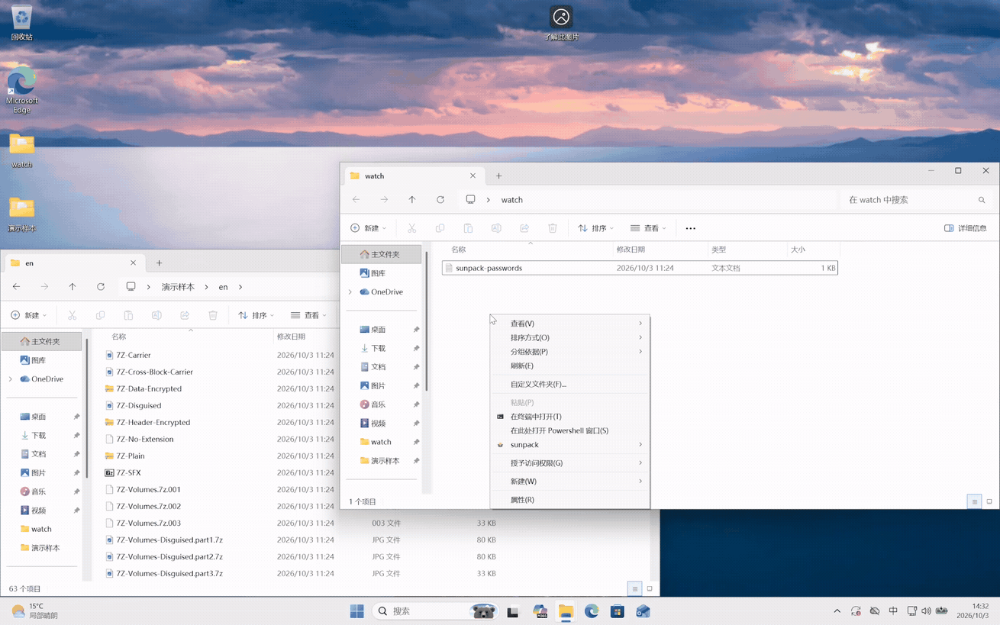
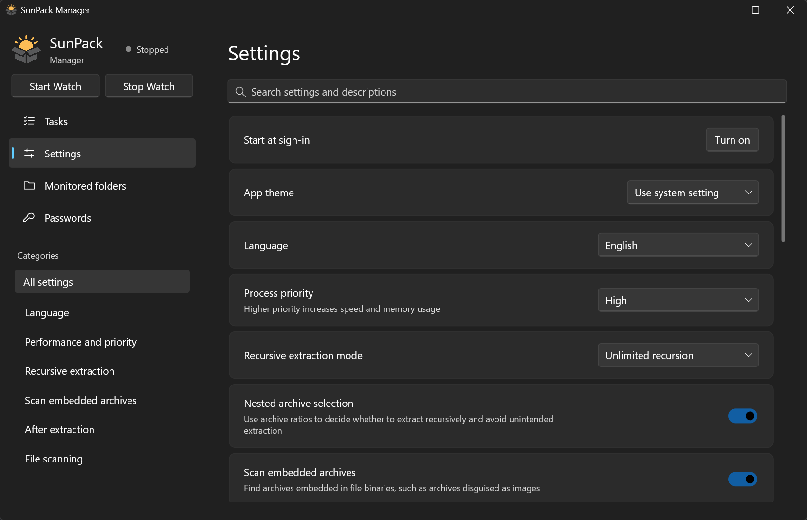

<p align="center"></p>
<h1 align="center">SunPack</h1>
<p align="center"><b>Windows용 자동 압축 해제 도구입니다. 폴더를 감시하고 백그라운드에서 압축 파일을 자동으로 풉니다.</b></p>

<p align="center"><a href="README.zh-CN.md">简体中文</a> · <a href="README.md">English</a> · <a href="README.zh-TW.md">繁體中文</a> · <a href="README.ja.md">日本語</a> · <b>한국어</b> · <a href="https://github.com/Qinjingxue/Sunpack/releases/latest">다운로드</a></p>

<p align="center"></p>

## 설치

SunPack은 Windows 10 버전 1709 이상과 Windows 11을 지원합니다. Watch에서 감시하는 폴더는 NTFS 또는 ReFS에 있어야 합니다.

1. [GitHub Releases](https://github.com/Qinjingxue/Sunpack/releases/latest)에서 `sunpack-windows-<arch>-<version>-setup.exe`를 받습니다. Intel/AMD 64비트 Windows에서는 `x64`, Windows on ARM에서는 `arm64`를 선택합니다.
2. 설치 프로그램을 실행하고 UAC 요청을 승인합니다. 기본 설치 경로는 `C:\Program Files\SunPack`입니다. Watch Broker 서비스를 설치하려면 관리자 권한이 필요합니다.
3. 필요한 경우 시스템 `PATH`에 추가하거나 탐색기의 마우스 오른쪽 버튼 메뉴와 Windows 로그인 시 Watch 시작을 설정합니다. PATH에 추가했다면 PowerShell을 다시 엽니다.

WinGet으로 자동 설치하려면 다음 명령을 실행합니다.

```powershell
winget install --id Qinjingxue.SunPack --exact --source winget --silent
```

## 사용법

| 명령 | 별칭 | 기능 |
| --- | --- | --- |
| `extract` | `e` | 압축을 풉니다. |
| `watch` | `w` | 폴더를 감시하고 쓰기가 끝난 파일을 자동으로 처리합니다. |
| `scan` | `s` | 압축 파일을 찾고 압축을 풀지 않은 상태로 암호를 확인합니다. |
| `passwords` | `pw` | 암호 후보의 출처를 표시합니다. |
| `config` | `cfg` | 유효한 설정을 표시하거나 검사합니다. |
| `daemon` | `d` | 백그라운드 프로세스와 로그인 시 시작을 관리합니다. |
| `doctor` | `doc` | 설치 상태와 실행 환경을 읽기 전용으로 검사합니다. |
| `version` | `ver` | 설치된 버전을 표시합니다. |

```powershell
sunpack extract D:\Downloads -o E:\Output -c k
sunpack watch add D:\Downloads -o E:\Output -R
sunpack daemon start
```

인수, 종료 코드 및 JSON 출력은 [CLI 옵션 설명](docs/ko/cli_parameters.md)을 참고하세요. 확장자가 위장된 파일 대부분은 일반 모드에서 찾을 수 있습니다. 일반 모드에서 찾지 못한 파일을 확인할 때 심층 검사(`-d`)를 사용하세요. 항상 켜 두면 의도하지 않은 내장 데이터도 추출될 수 있습니다.

### 관리 화면과 암호

시작 메뉴의 SunPack GUI 또는 Watch 알림 영역 아이콘에서 관리 화면을 엽니다. 이 화면에서 작업 내역, 감시 폴더, 암호 및 설정을 관리합니다. GUI는 네이티브 C++로 구현되어 있으며 창을 닫으면 종료됩니다.

설정 화면에서 한국어를 선택할 수 있습니다. `sunpack_config.json`을 직접 편집할 때는 `cli.language`를 `ko`로 설정합니다.

설치 버전의 암호 파일은 `%ProgramData%\SunPack\builtin_passwords.json`입니다. 암호 관리 화면에서 폴더별 암호를 편집하거나 클립보드 기록을 암호 후보로 저장할 수 있습니다. JSON의 `value`에는 암호를, `enabled`에는 사용 여부를 지정합니다. 선택 항목인 `scopes`에는 절대 경로를 지정하며, 생략하면 모든 폴더에 적용됩니다. Watch는 별도의 `clipboard_history`에 기본적으로 최근 30개 항목을 보관합니다.

CLI의 `-p`, `-P`, 대화형 입력 및 현재 클립보드도 후보가 될 수 있습니다. 최근 성공한 암호는 유효한 후보의 순서를 조정하는 데만 사용됩니다. 암호 후보와 분할 볼륨을 확인하는 동안 진행률이 0%에 머물 수 있습니다. 진행 알림에서 작업을 취소할 수 있습니다.



## 주요 기능

- **압축 파일 식별**. 바이너리 내용을 기준으로 확장자가 위장된 파일, 다른 파일에 내장된 압축 데이터, 분할 압축 파일을 식별합니다. ZIP, ZIPX, RAR3/4/5, 7z(Zstandard 및 LZ4 포함), Zstandard, gzip, bzip2, TAR, XZ, LZ4와 독립 ENC v4 파일을 지원합니다. WinZip 전용 ZIPX JPEG·MP3·WavPack 방식과 레거시 또는 사전을 사용하는 LZ4는 지원 대상에서 제외됩니다.
- **재귀 압축 해제와 후처리**. 압축을 푼 결과에 포함된 압축 파일도 이어서 처리할 수 있습니다. 완전히 성공하면 기본적으로 원본을 휴지통으로 보냅니다. 시딩 등으로 원본을 유지해야 할 경우 `post_extract.archive_cleanup_mode`를 `k`로 설정하세요.
- **Watch**. 쓰기가 안정된 파일을 처리합니다. 누락된 볼륨이 도착하거나 암호 후보가 변경되면 관련 작업을 다시 시도합니다. 감시 루트별 출력 위치를 지정하고 Windows 알림에서 진행률을 확인할 수 있습니다.
- **장애 복구**. 디스크 공간이 부족하면 일시 중지하고 공간이 확보되면 다시 시작합니다. WAL 체크포인트를 사용해 종료 후 복구할 수 있습니다. 부분 결과를 허용하면 파일 손상이나 누락된 볼륨이 있더라도 쓰기가 완료된 파일을 유지할 수 있습니다.
- **동시 처리와 자원 관리**. Rust와 C++ 네이티브 코드 및 중첩 I/O로 여러 압축 파일을 처리합니다. 유휴 상태는 이벤트 기반으로 대기하며, 작업 이후 불필요한 캐시를 해제합니다.

## 설정

설치 버전에서는 보통 `%ProgramData%\SunPack\sunpack_config.json`을 편집합니다. `sunpack_advanced_config.json`은 나머지 기본값을 제공합니다. 두 파일에 같은 설정이 있으면 일반 설정이 우선합니다. Watch는 변경 사항을 자동으로 다시 읽습니다.

```powershell
sunpack config validate
sunpack config show
```

언어, 검색 필터, 재귀 압축 해제, 중복 제거, 업그레이드 시 설정 이전은 [설정 가이드](docs/ko/configuration.md)를 참고하세요.

## 개발 및 테스트

Windows 10/11 x64 또는 Windows 11 ARM64, PowerShell 5.1 이상, Git for Windows, uv 0.12 이상, rustup 및 Rust MSVC 도구 체인이 필요합니다. Visual Studio 2022 또는 Build Tools 2022에서 C++ 데스크톱 개발 워크로드, MSVC, Windows SDK를 설치합니다. ARM64 빌드에는 해당 MSVC 도구와 Windows용 C++ Clang 도구도 필요합니다. 설치 패키지를 만들려면 Inno Setup 6을 설치합니다.

```powershell
.\scripts\setup_windows_dev.ps1
uv sync --locked --extra test
uv run --locked pytest
.\run_acceptance_tests.ps1
.\scripts\build_windows.ps1
```

ARM64 네이티브 개발과 인수 테스트에는 `-Arch arm64`를, x64에서의 ARM64 교차 빌드에는 `-Arch arm64 -SkipAcceptanceTestTools`를 사용합니다.

Rust가 검색, 형식 분석, 암호 및 볼륨 확인, 처리 계획을 담당하고 7-Zip 소스를 내장한 C++ worker가 압축을 풉니다. [개발 환경과 빌드](docs/ko/development_setup.md), [개발 계층의 책임 범위](docs/ko/development_boundaries.md), [worker와 7-Zip의 재현 가능한 비교](docs/ko/benchmark_worker_vs_7z_300m.md)를 참고하세요. 저장소를 수정할 때는 [AGENTS.md](AGENTS.md)의 개발 규칙을 따르세요.

## 알려진 문제

형식에 따라 암호 후보별 검사 비용이 높아 후보가 많으면 진행률이 오랫동안 0%에 머물 수 있습니다. 이 경우 작업을 중단하고 후보를 줄이세요.

## 기여

문제 보고와 제안은 [GitHub Issues](https://github.com/Qinjingxue/Sunpack/issues)에, 코드 변경은 [Pull Request](https://github.com/Qinjingxue/Sunpack/pulls)에 올려 주세요. 필요한 경우 다음 로그를 첨부할 수 있습니다.

- Watch 이벤트: `%ProgramData%\SunPack\.sunpack_watch\events.json` 및 `events.json.store`
- 압축 해제 실패 보고서: `%ProgramData%\SunPack\.sunpack_watch\failures\failed-*.txt`
- 백그라운드 런타임: `%ProgramData%\SunPack\runtime-*.state.events.json` 및 대응하는 `.store`

내역 매니페스트와 이에 대응하는 `.store`를 함께 첨부하세요. 공유하기 전에 암호와 개인 경로를 제거하세요.

## 감사의 말과 라이선스

모든 기여자 및 사용자와 [Core UI](https://github.com/ghboke/core-ui), [7-Zip](https://www.7-zip.org/), [zlib-ng](https://github.com/zlib-ng/zlib-ng), [LZ4](https://github.com/lz4/lz4), [RustCrypto](https://github.com/RustCrypto) 개발자에게 감사드립니다.

SunPack 자체 코드는 [MIT 라이선스](LICENSE)를 따릅니다. 타사 소스와 바이너리는 각각의 원래 라이선스를 따릅니다. [타사 고지](THIRD_PARTY_NOTICES.md), [라이선스 원문](licenses/), [라이선스와 배포](docs/ko/licensing.md)를 참고하세요.
