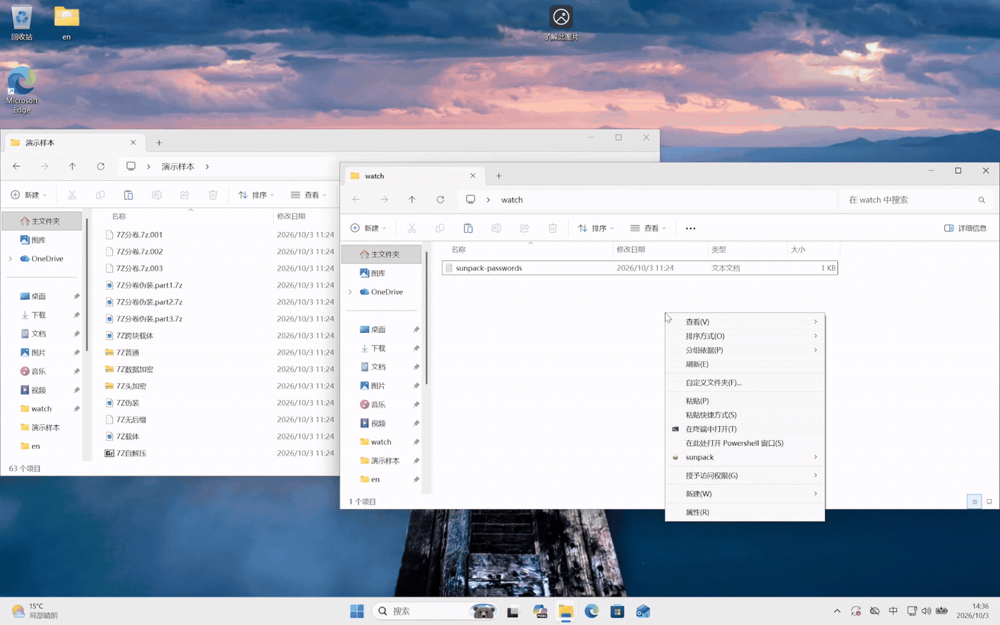
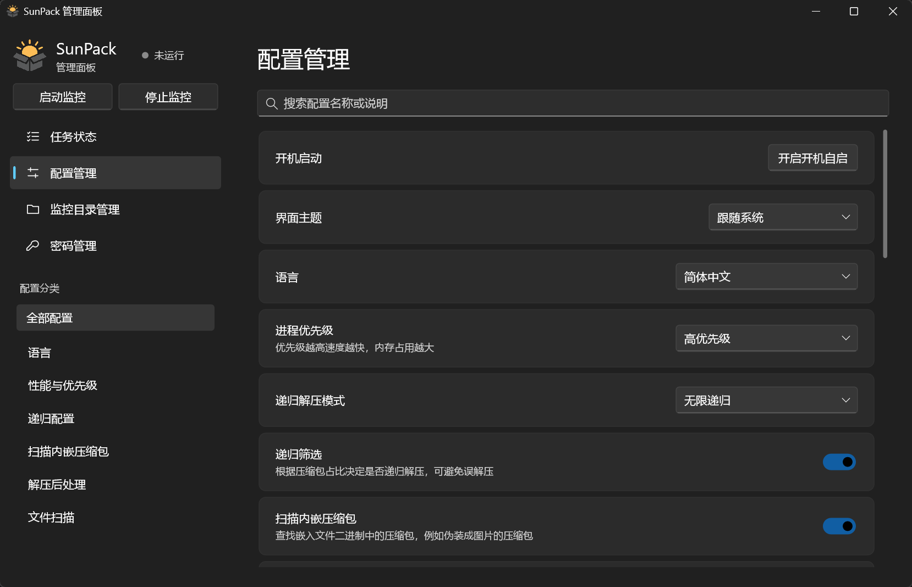

<p align="center">
  
</p>
<h1 align="center">SunPack</h1>
<p align="center"><b>適用於 Windows 的全自動壓縮檔處理工具，可在背景自動解壓縮</b><br></p>

<p align="center"><a href="README.zh-CN.md">简体中文</a> · <a href="README.md">English</a> · <b>繁體中文</b> · <a href="README.ja.md">日本語</a> · <a href="README.ko.md">한국어</a> · <a href="https://github.com/Qinjingxue/Sunpack/releases/latest">下載</a></p>

<p align="center">
  <a href="https://github.com/Qinjingxue/Sunpack/releases/latest"></a>
  
  <a href="https://github.com/Qinjingxue/Sunpack/blob/main/LICENSE"></a>
</p>

<p align="center">
  
</p>

---

## 內容導航

- [安裝說明](#安裝說明)
- [使用指南](#使用指南)
  - [命令速覽](#命令速覽)
  - [密碼管理](#密碼管理)
  - [GUI管理面板](#gui管理面板)
  - [使用注意](#使用注意)
- [核心能力](#核心能力)
  - [遞迴處理](#遞迴處理)
  - [後處理](#後處理)
  - [Watch模式監控系統](#watch模式監控系統)
  - [可靠性與-wal-當機復原](#可靠性與-wal-當機復原)
  - [高並行度與效能最佳化](#高並行度與效能最佳化)
  - [背景低資源占用](#背景低資源占用)
- [設定](#設定)
- [開發與測試](#開發與測試)
  - [開發相關](#開發相關)
  - [架構速覽](#架構速覽)
  - [測試](#測試)
  - [可重現的 worker 與 7-Zip 對比測試](#可重現的-worker-與-7-zip-對比測試)
- [已知問題](#已知問題)
- [參與貢獻](#參與貢獻)
- [致謝](#致謝)
- [授權條款](#授權條款)

## 安裝說明

### 系統要求

SunPack 僅支援 Windows 10 版本 1709 及更高版本和 Windows 11。其中Watch 模式支援 NTFS 和 ReFS 檔案系統。

從 [GitHub Releases](https://github.com/Qinjingxue/Sunpack/releases/latest) 下載最新的 `sunpack-windows-<arch>-<version>-setup.exe`。

1. 根據系統架構選擇安裝套件：Intel/AMD 64 位 Windows 選擇 `x64`，Windows on ARM 選擇 `arm64`。
2. 執行安裝程式並接受 UAC 提權。預設安裝到 `C:\Program Files\SunPack`；安裝 Watch Broker 服務需要管理員權限。
3. 按需選擇安裝向導中的附加項：
   - 將安裝目錄加入本機 `PATH`。完成安裝後請重新打開 PowerShell。
   - 註冊檔案總管中的資料夾、資料夾背景右鍵選單。
   - 隨 Windows 啟動 SunPack Watch（預設不啟用）。

也可以透過 WinGet 靜默安裝：

```powershell
winget install --id Qinjingxue.SunPack --exact --source winget --silent
```

---

## 使用指南

### 命令速覽

| 命令        | 簡寫  | 說明                                         |
| ----------- | ----- | -------------------------------------------- |
| `extract`   | `e`   | 解壓縮檔案                                     |
| `watch`     | `w`   | 監控目錄，發現壓縮檔案後自動解壓縮             |
| `scan`      | `s`   | 唯讀掃描壓縮檔並確認密碼         |
| `passwords` | `pw`  | 查看本次會參與嘗試的密碼清單。               |
| `config`    | `cfg` | 查看或驗證目前有效設定                       |
| `daemon`    | `d`   | 啟停背景程序及管理登錄啟動項                 |
| `doctor`    | `doc`   | 非破壞性檢查安裝狀態和執行環境               |
| `version`   | `ver` | 輸出目前安裝的 SunPack 版本號                |

> 詳細參數見 [CLI 參數說明](docs/zh-TW/cli_parameters.md)。

### 密碼管理

在[GUI管理面板](#gui管理面板)的“密碼管理”頁中，可按目錄編輯密碼，或將剪貼簿歷史儲存為候選密碼。

Sunpack為達到最大方便性，在使用時會嘗試從各處獲取密碼，高速嘗試所有候選密碼，在上千候選密碼下幾乎無感速度，自動找到正確密碼並使用，使用的密碼來源有：

- JSON 密碼檔案：安裝版位於 `%ProgramData%\SunPack\builtin_passwords.json`，可在管理面板的“密碼管理”頁面編輯。`passwords` 中的記錄使用 `value` 儲存密碼，可用 `scopes` 指定多個絕對目錄；省略即全局生效。Watch 自動維護獨立的 `clipboard_history`，預設最多 30 條。密碼清單用布林欄位 `enabled` 控制是否作為候選密碼。
- 使用者輸入：右鍵選單，CLI調出的交互輸入密碼模式的輸入
- 剪貼簿：解壓縮前自動讀取剪貼簿文字作為密碼

最近成功記錄僅調整本次有效候選的順序，不會擴大密碼範圍。密碼檔案變化透過檔案事件熱更新。

驗證密碼和分卷候選期間，解壓縮進度會暫時顯示為 0%；候選較多或驗證成本較高時可能持續較久，可以透過進度通知取消任務。

### GUI管理面板

從 Watch 系統匣或開始選單開啟 SunPack GUI，即可管理任務、監控資料夾、密碼與設定。

- **程式小巧**：GUI 本體約 4 MB，記憶體占用低。
- **不必額外執行階段**：採用原生 C++ 與 Windows 風格介面，不依賴瀏覽器核心、.NET 等外部執行階段。
- **啟動快、操作流暢**：打開和交互響應迅速，任務、目錄、密碼與設定一屏管理。
- **用完即退出**：關閉視窗後 GUI 完全退出，不在背景常駐。



### 使用注意

- 深度偵測參數：程式在正常模式已經能夠偵測幾乎所有偽裝檔案，深度偵測參數請僅在程式遇到某些強偽裝的檔案，正常無法辨識時開啟，日常開啟會導致誤解壓縮大量正常檔案。

---

## 核心能力

### 辨識能力

- 透過檔案二進位資料辨識潛在的壓縮檔案，支援偽裝副檔名、載體和分卷。支援 ZIP、ZIPX、RAR3/4/5、7z（含 7z-Zstandard 與 7z-LZ4）、Zstandard、gzip、bzip2、TAR、XZ、LZ4 和獨立 ENC v4 檔案。ZIPX 不支援 WinZip 專用 JPEG、MP3、WavPack 演算法，LZ4 不支援 legacy 和 dictionary。

### 遞迴處理

- 預設遞迴尋找巢狀壓縮檔，即在解壓縮成功後的資料夾下尋找是否有明顯的需要進一步解壓縮的壓縮檔並進行遞迴處理，該演算法經過最佳化，大部分情況下不會誤解壓縮不應進一步解壓縮的檔案

### 後處理

- 自動在解壓縮成功後攤平無意義巢狀單子目錄，只保留頂層資料夾，並將原壓縮檔案移至資源回收筒或者永久刪除（設定："archive_cleanup_mode": "r"調整，預設移至資源回收筒），如果處理出錯會自動清理錯誤輸出並回報錯誤
- 如果監控的資料夾內，下載的檔案是需要進行BT做種的，請手動調整"archive_cleanup_mode": "r"至"k"，不然來源檔案可能存在競態被迅速刪除

### Watch模式監控系統

- watch監控系統基於精心設計的辨識演算法，監控並處理壓縮檔案，能夠迅速監控並辨識對應目錄新增的壓縮檔案，不處理非壓縮檔案
- 能夠辨識缺失分卷或密碼的情境，並在密碼來源或者分卷變化後自動重試。進行處理時使用windows通知來顯示進度
- 每個監控目錄可以設定獨立的輸出根目錄，具體命令和持久化格式見 [CLI 參數說明](docs/zh-TW/cli_parameters.md)。

### 可靠性與 WAL 當機復原

- 在磁碟空間不足時自動暫停解壓縮任務，並能夠自動在磁碟空間充足後繼續解壓縮，不必手動重試
- 擁有檔案驗證系統，允許部分損壞檔案解壓縮出部分可用檔案，而不是一次性失敗，完全失敗時也能自動清理損壞檔案，不會殘留需手動清理的遺留檔案
- 採用類似資料庫的WAL思想，解壓縮處理過程中意外斷電或程序當機不會留下半成品或損壞狀態，程式能正確處理並在復原後完成任務
- 測試體系涵蓋多種複雜封存檔、並發與當機復原情境，用於持續驗證處理正確性。

### 高並行度與效能最佳化

- 一次性可並發處理大量封存檔檔案，且有一套並發演算法來合理分配並發，在多檔案解壓縮情境下不必手動單獨解壓縮，將檔案放入一個目錄內即可自動迅速完成解壓縮
- 高效能計算和IO部分使用Rust和C++原生程式碼處理，且使用overlapped IO，重疊7z解壓縮時的讀取，計算和輸出部分，擁有較好的資源利用能力
- 7z後端解碼器上，使用zlib-ng最佳化了7z的Deflate解碼速度，使用並發計算最佳化了rar和bz2的解碼速度
- 針對各種情境有豐富benchmark案例，針對benchmark最佳化接近可維護性上限

### 背景低資源占用

- 快取生命週期管理完善，自動在處理檔案後釋放無用快取
- 系統閒置時完全事件通知，背景閒置無輪詢偵測占用CPU

---

## 設定

主設定檔案是 `sunpack_config.json`，`sunpack_advanced_config.json` 提供其餘預設值。Watch 會自動重新載入設定變更。

若要切換為繁體中文，請在管理面板的設定頁選擇語言，或將 `sunpack_config.json` 的 `cli.language` 設為 `zh-TW`。

一般設定的同名值優先於進階設定。升級時只保證保留目前一般設定，不保留手動複製到一般設定中的僅限進階欄位。

設定驗證命令：

```powershell
sunpack config validate
```

常用設定和範例見 [設定指南](docs/zh-TW/configuration.md)。

---

## 開發與測試

### 開發相關

執行開發腳本前，請準備以下環境。

- Windows 10/11 x64 或 Windows 11 ARM64，使用 PowerShell 5.1 或更新版本。
- Git for Windows、uv 0.12 或更新版本、rustup，以及 rustup 管理的 Rust MSVC 工具鏈。確保 `git`、`uv`、`rustup`、`cargo` 在 PATH 中。
- Visual Studio Build Tools 2022 或 Visual Studio 2022，安裝 **使用 C++ 的桌面開發** 工作負載、MSVC 工具集及 Windows SDK。建置 ARM64 時還需要 MSVC ARM64 建置工具和 **C++ Clang tools for Windows**（`clang-cl`）。
- 首次準備 Python、Cargo 依賴和測試工具需要聯網。腳本透過 uv 準備 Python、`.venv` 和 CMake，並透過 rustup 補齊所選架構的 Rust target。

```powershell
.\scripts\setup_windows_dev.ps1
```

在 Windows 11 ARM64 上使用 `-Arch arm64` 準備原生開發和驗收環境。在 x64 上交叉建置 ARM64 時使用 `-Arch arm64 -SkipAcceptanceTestTools`。

產生 Windows 安裝套件前，另外安裝 Inno Setup 6。

```powershell
.\scripts\build_windows.ps1
```

腳本選項、測試和發行流程見 [開發文件](docs/zh-TW/development_setup.md)。
開發邊界見文件 [文件](docs/zh-TW/development_boundaries.md)
使用AI開發者務必使AI閱讀倉程式庫內的AGENTS.md進行開發，並遵守開發規范

### 架構速覽

```text
CLI / Watch / 檔案總管（runtime）
  -> 流程協調器（pipeline）
     -> 檔案系統掃描與分流
        +-- Relations：RAR / 7z / ZIP，含分卷
        +-- Detection：TAR 和壓縮串流
        +-- Embedded：處理未辨識檔案中的嵌入封存檔
     -> 遞迴授權 -> 密碼處理 -> 解壓縮
     -> 彙整執行結果 -> 後處理
```

Rust 負責底層掃描和封存檔分析；C++ worker 集成 7-Zip 原始碼執行解壓縮。

### 測試

安裝測試依賴並執行預設測試：

```powershell
uv sync --locked --extra test
uv run --locked pytest
```

驗收測試：

```powershell
.\run_acceptance_tests.ps1
```

### 可重現的 worker 與 7-Zip 對比測試

詳細的機器資訊、封存檔構造、壓縮方法和重現說明見[獨立 benchmark 文件](docs/zh-TW/benchmark_worker_vs_7z_300m.md)。
以下結果使用 **SunPack v0.7.9**，倉程式庫與 worker 原始碼提交均為 `b9fdfa6d`。
測試日期為 2026-10-03，共 18 個 case，每個測量 5 次、不預熱。耗時和程序樹
取樣峰值 RSS 均為每個 case 的中位數，RSS 單位為 MiB。表中先展示 worker 的
耗時和記憶體，再展示 `7z.exe` 的對應資料。全矩陣報告位於
`benchmarks/results/worker-vs-7z-300m-v0.7.9-b9fdfa6-rss-20261003.json`。

| 格式 / 變體    | Worker 耗時（ms） | `7z.exe` 耗時（ms） | 耗時比 | Worker 峰值 RSS（MiB） | `7z.exe` 峰值 RSS（MiB） | RSS 比 |
| -------------- | :---------------- | :------------------ | :----- | :--------------------- | :----------------------- | :----- |
| 7z split       | 141.886           | 203.605             | 0.697  | 476.199                | 458.379                  | 1.039  |
| 7z non-solid   | 188.029           | 250.020             | 0.752  | 324.137                | 308.047                  | 1.052  |
| 7z solid       | 142.802           | 204.641             | 0.698  | 475.652                | 458.309                  | 1.038  |
| BZip2          | 1,670.859         | 2,914.191           | 0.573  | 43.289                 | 12.625                   | 3.429  |
| Gzip           | 81.731            | 209.743             | 0.390  | 25.188                 | 8.215                    | 3.066  |
| RAR5 split     | 172.453           | 768.066             | 0.225  | 54.242                 | 40.516                   | 1.339  |
| RAR4 non-solid | 80.926            | 185.464             | 0.436  | 27.488                 | 11.598                   | 2.370  |
| RAR4 solid     | 539.789           | 652.330             | 0.827  | 28.211                 | 12.348                   | 2.285  |
| RAR5 non-solid | 95.293            | 186.992             | 0.510  | 56.250                 | 39.605                   | 1.420  |
| RAR5 solid     | 168.938           | 745.597             | 0.227  | 57.289                 | 40.477                   | 1.415  |
| TAR            | 76.350            | 120.331             | 0.634  | 24.031                 | 7.297                    | 3.293  |
| TBZ2           | 1,663.736         | 2,890.008           | 0.576  | 44.141                 | 12.625                   | 3.496  |
| TGZ            | 84.974            | 213.233             | 0.399  | 25.215                 | 8.219                    | 3.068  |
| TXZ            | 156.893           | 181.328             | 0.865  | 474.617                | 458.523                  | 1.035  |
| TZST           | 100.259           | 188.752             | 0.531  | 23.012                 | 9.789                    | 2.351  |
| XZ             | 169.011           | 183.459             | 0.921  | 474.621                | 458.520                  | 1.035  |
| ZIP            | 76.254            | 198.892             | 0.383  | 25.289                 | 7.984                    | 3.167  |
| ZST            | 104.599           | 181.936             | 0.575  | 23.039                 | 9.789                    | 2.354  |

---

## 已知問題

- 部分壓縮檔案因資訊限制，無法低成本快速嘗試密碼。密碼候選較多時，解壓縮進度可能長時間停留在 0，且程式無響應；請手動停止解壓縮並減少密碼候選。

## 參與貢獻

歡迎透過 [GitHub Issues](https://github.com/Qinjingxue/Sunpack/issues) 報告問題、提出建議，也歡迎提交 [Pull Request](https://github.com/Qinjingxue/Sunpack/pulls) 改進項目。

報告問題時可附上相關日誌。安裝版預設位置：

- Watch 事件：`%ProgramData%\SunPack\.sunpack_watch\events.json` 和 `events.json.store`
- 解壓縮失敗報告：`%ProgramData%\SunPack\.sunpack_watch\failures\failed-*.txt`
- 背景 Runtime：`%ProgramData%\SunPack\runtime-*.state.events.json` 及對應 `.store` 目錄

顯示歷史清單與對應 `.store` 資料目錄需一起打包，不是可逐行讀取的 JSONL。狀態目錄固定為資料目錄下的 `.sunpack_watch`。提交前請刪除日誌中的密碼、私人路徑等敏感資訊。

## 致謝

感謝所有為 SunPack 提交程式碼、報告問題和提供建議的貢獻者與使用者。SunPack 也受益於眾多開放原始碼項目，特別感謝 [Core UI](https://github.com/ghboke/core-ui)（SunPack 的原生 UI 技術棧）、[7-Zip](https://www.7-zip.org/)、[zlib-ng](https://github.com/zlib-ng/zlib-ng)、[LZ4](https://github.com/lz4/lz4) 和 [RustCrypto](https://github.com/RustCrypto) 項目及其維護者。相關第三方元件和授權條款資訊見 [THIRD_PARTY_NOTICES.md](THIRD_PARTY_NOTICES.md)。

## 授權條款

倉程式庫根目錄的 [LICENSE](LICENSE)（MIT）適用於 SunPack 原創程式碼，不代表第三方程式碼或二進位也採用 MIT 授權條款。

倉程式庫包含多個第三方元件，包括位於 `sunpack/sevenzip_bridge/7z2604-src/` 的 7-Zip 26.05 裁剪定制實現（沿用原目錄名）、位於 `sunpack/sevenzip_bridge/zlib-ng-2.3.3/` 的 zlib-ng 2.3.3、位於 `sunpack/third_party/lz4/` 的 LZ4 1.10.0，以及改編自 RustCrypto 的加密演算法實現。這些元件仍受各自原始授權條款約束。各元件的範圍、版權與授權條款資訊，以及發行時需要附帶的許可材料，詳見 [THIRD_PARTY_NOTICES.md](THIRD_PARTY_NOTICES.md)、[licenses/](licenses/) 和 [docs/licensing.md](docs/zh-TW/licensing.md)。

其中，7-Zip 原始碼授權條款副本位於 [licenses/7zip-source-license.txt](licenses/7zip-source-license.txt)，GNU LGPL 2.1 完整文字位於 [licenses/LGPL-2.1.txt](licenses/LGPL-2.1.txt)；其他元件的授權條款副本見 [licenses/](licenses/)。
