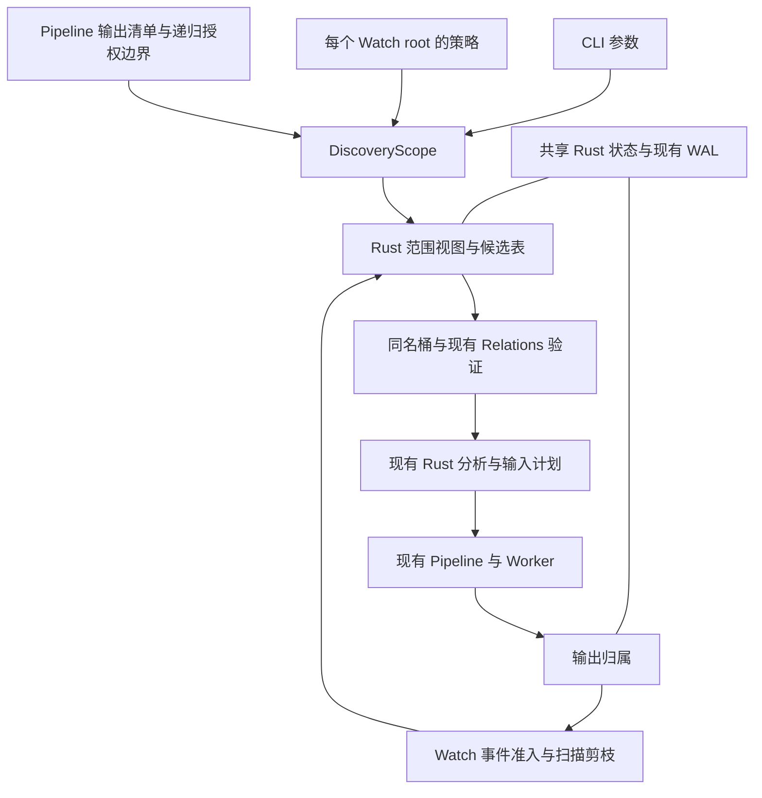

# SunPack 统一发现与递归监控改造方案

依据：根目录《讨论内容.md》及本地提交 `b68d9c0d` 的代码。日期：2026-10-23。

本文是实施设计，不代表功能已经实现或性能已经验证。目标是让 CLI、Watch、内部递归共用范围与分卷模型，并保留现有 Rust 分析、调度、验证和后处理链路。

## 1. 核心决策

最终只需要解释清楚三件事：

1. **DiscoveryScope：本次允许在哪里发现输入、在哪里寻找分卷。**
2. **Relations：在该范围内，根据已有结构证据确认哪些文件属于同一归档。**
3. **OutputOwnership：哪些目录正在或已经由 Pipeline 生成，Watch 不应将其当作外部输入。**

RuntimeHost 持有共享服务的生命周期；Pipeline 写输出归属；Watch 消费范围和归属。配置字段升级独立放在安装器中。



不新增第二个 Runtime、第二套归档识别器、第二套补卷器或独立数据库。范围、名字索引和归属索引在 Rust 中执行；Python 传递小型策略、句柄和最终任务。

## 2. 代码核对与讨论中需要补正的部分

| 当前代码事实 | 位置 | 对改造的影响 |
| --- | --- | --- |
| 已有 RuntimeHost、持久进程和共享 PipelineEngine | `sunpack/runtime/cli/runtime_host.py:22`、`persistent_runtime.py:151` | 可以直接共享生命周期，无需先做新的全局服务 |
| 文件系统递归由配置隐式决定 | `sunpack/pipeline/discovery/filesystem/directory_scanner.py:33` | 必须移除底层再次读配置决定范围的行为 |
| 原生快照和 NativeCandidateTable 已贯通发现链路 | `sunpack/pipeline/coordinator/scan_session.py:137`、`target_scan.py:38` | 以原生表及行索引扩展，避免搬成 Python 文件列表再搬回去 |
| RelationScopeIndex 先按父目录分区，再按 stem 召回 | `native/sunpack_native/src/relations/scope.rs:128` | 不能只改扫描深度；关系上下文必须一起改 |
| Rust 补卷要求 single_directory_scope，Python 也重新枚举同目录 | `native/sunpack_native/src/relations/mod.rs:1127`、`sunpack/pipeline/discovery/relations/internal/group_builder.py:154` | 首次发现和缺卷重试必须同改，删除旧的目录专用接口 |
| 大小过滤分卷保护的 family key 含路径前缀 | `native/sunpack_native/src/relations/mod.rs:1362` | 分卷保护必须改用同一范围内的命名身份 |
| 默认输出按 task.main_path 定位；指定 output root 时会保留相对父目录 | `sunpack/core/support/output_paths.py:11`、`sunpack/runtime/watch/scheduler.py:1736` | CLI 默认旁置可延续；递归 Watch 首轮需明确直接输出到 root 映射目录，不能照搬相对路径重映射 |
| Watch 固定为非递归，准入也只认直接子文件 | `sunpack/runtime/watch/scheduler.py:183`、`:2165` | Observer、准入、扫描、恢复应全部消费同一个 scope |
| Watch 目录创建被忽略，移动只处理来源，不扫描目录目标 | `sunpack/runtime/watch/scheduler.py:2210`、`:2238` | 必须补齐整目录移入和根目录重建 |
| 当前输出开始/结束事件只对 watch origin 产生 | `sunpack/pipeline/coordinator/archive_job.py:130`、`:202` | 必须改为所有 Pipeline 入口的直接生命周期调用 |
| active_outputs / committed_roots 隶属待恢复工作 | `sunpack/runtime/watch/state.py:99`、`:924` | 可复用 WAL，不能把这些临时字段直接当永久归属表 |
| 完成输出缓存容量为 4096，且只在内存中 | `sunpack/pipeline/coordinator/engine.py:380`、`:624` | 无法独自支持重启后的成功源去重 |
| 压平先把根改名为旁边的工作目录，再提升内部目录 | `native/sunpack_native/src/postprocess/mod.rs:361`、`:431` | 既有路径迁移，也有同路径目录身份替换，必须提前保护工作路径 |
| USN 恢复只筛选根及直接子项；回退也是浅扫 | `native/sunpack_usn_core/src/journal.rs:336`、`sunpack/runtime/watch/scheduler.py:414` | 递归恢复必须改协议和原生实现，不能只打开 recursive |
| roots 已有四列，GUI 与 Runtime 各有读写器 | `sunpack/runtime/watch/service.py:198`、`gui/src/model.cpp:387` | 新标志追加为第五列，不能占用 initial_scanned |
| 安装器在 PrepareToInstall 删除旧程序目录 | `installer/SunPack.iss:798` | 旧高级配置必须在删除前保存 |
| 升级路径会调用按当前提升进程 SID 重设 ACL 的逻辑 | `installer/SunPack.iss:368`、`:849` | 迁移脚本保留 ACL 还不够，安装器也不能随后重置它 |

另外，`RuntimeHost.foreground_started()` 中的 gate 用于与空闲缓存维护协调。核对 `WatchScheduler.set_external_activity()` 后，不能将它误解为已经解决 CLI 与 Watch 输出隔离的机制，也不应为了本次改造删除这个合理的维护互斥。

## 3. 先固定用户可见语义

### 3.1 两种递归保持独立

- `--recursive`：递归发现输入目录，默认关闭，统一用于 `scan`、`inspect`、`extract`。
- `-r / --recur`：现有嵌套归档解压策略，继续保留。
- 删除 `filesystem.directory_scan_mode`，包括模板、字段注册、显示信息、GUI 项和文档。

`--recursive` 不修改嵌套解压配置。当前高级配置的 `recursive_extract` 默认是 `*`，因此不能把“只加 --recursive”解释为一定不解压嵌套归档；实际行为仍取决于原有嵌套策略。

```text
sunpack scan D:\Downloads --recursive
sunpack inspect D:\Downloads --recursive
sunpack extract D:\Downloads --recursive --recur *
sunpack watch add D:\Downloads --recursive --start
```

共享 argparse 参数定义，但在入口只构造一次 Scope；下游不再读取 argv 或配置猜测是否递归。

### 3.2 不同来源的范围

| 来源 | 发现范围 | 分卷上下文 |
| --- | --- | --- |
| CLI 目录，未加参数 | 该目录直接文件 | 同一浅层范围 |
| CLI 目录，加 --recursive | 该目录可进入的子树 | 同一递归范围，可跨子目录 |
| CLI 指定文件 | 仅该文件是执行种子 | 父目录浅层上下文，只召回该文件相关分卷，不执行无关归档 |
| CLI 多个互不包含的目录 | 每个目录各自一个范围 | 不取公共祖先，不跨多个独立范围猜测归属 |
| 显式 all_parts 输入 | 显式成员集合 | 允许其物理路径不同，仍经过现有结构验证 |
| Watch | 对应 root 的独立 recursive 策略 | 同一个有效范围，排除受保护输出和其他明确排除子树 |
| Pipeline 内部递归 | 已有输出清单对应的逻辑根 | 只在该逻辑根内找卷，继续执行 RecursiveAuthorization |

Watch 的两个重叠 root 采用“最具体的显式 root 管理其整棵子树”。父 scope 剪掉子 root 的子树；子 root 非递归时，更深层文件不会被父 root 重新接管。这样每个路径只有一套输出、密码和扫描策略。

CLI 的包含目录参数先合并等价发现范围；需要不同逐目标输出策略时，仍保留现有 PipelineTarget 路由，不通过隐式公共祖先扩大范围。内部载体的各个 confirmed segment 继续拥有独立逻辑根，不能因为共用物理外壳就合桶。

### 3.3 输出路径：发现范围不决定输出位置

递归只扩大发现与分卷关系范围，不使 CLI 的输出跟随扫描根，也不使 Watch 的输出跟随每个归档所在的子目录。

| 场景 | 输出基目录 | 示例 |
| --- | --- | --- |
| Watch 首轮外部输入 | 归档所属 Watch root 映射的 output_root，直接在其下按归档逻辑名建目录，不附加输入的相对子目录 | 监控 `C:/A`，映射输出 `C:/A`，发现 `C:/A/B/movie.zip`，输出 `C:/A/movie` |
| Watch 映射到其他目录 | 同样直接使用该映射目录 | 上例映射改为 `D:/Out`，输出 `D:/Out/movie` |
| CLI 目录递归发现，未显式指定输出目录 | 每个归档自身所在目录 | 扫描 `C:/A`，发现 `C:/A/B/movie.zip`，输出 `C:/A/B/movie` |
| CLI 跨目录分卷，未显式指定输出目录 | Relations 最终选定入口卷所在目录 | 入口卷在 `C:/A/B`，其他卷在 `C:/A/C`，输出仍为 `C:/A/B/movie` |
| Pipeline 内部嵌套解压 | 延续现有生成归档旁置语义，在本次已生成的输出树内继续处理 | `C:/A/movie/data/inner.zip` 输出到 `C:/A/movie/data/inner` |

以上示例是预期首选路径，沿用现有 logical_name 和冲突编号规则；不是把文件直接散写进 `C:/A` 或 `D:/Out`。CLI 显式 `-o / --out-dir` 继续使用既有输出覆盖与相对路径规则，本次不改成被 --recursive 或扫描根隐式覆盖。

“锚点卷位置”在实现中统一指 Relations 确认的执行入口 `ArchiveInputDescriptor.entry_path`，也就是 `ArchiveTask.main_path`。当前原生 Proposal 优先取逻辑编号 1 的卷，不存在时取已有 proposal 的首个成员；不能拿触发 Watch 事件的卷、最先到达的卷、路径排序第一项或任意结构探测 seed 来决定输出位置。新卷补全后沿用该入口选择权威，不增加 Python 的锚点推断。输出完成预占并开始写入后，保持本次输出归属稳定。

对 Watch 分卷组，入口卷只决定任务身份和命名；首轮输出基目录仍取该 scope 关联的 Watch root 映射。不同显式 Watch root 不合桶，因此不会出现同组跨两个输出映射的仲裁。

实现时在任务绑定目标的既有链路中明确输出基目录/路由，交给同一个输出路径函数和 OutputReservationRegistry 完成命名与预占。无需另加用户配置，也不在下游多处按 origin 猜路径。Watch 首轮固定映射与内部嵌套旁置必须明确区分，不能把所有深度的输出都重新集中到 Watch 根。

现状核对：CLI 无 output root 时已经按 main_path 旁置；Watch 当前只有浅层输入，所以尚不存在可验证的递归输出行为。现有通用函数在有 output root 时会保留相对父目录，直接打开递归会得到 `C:/A/B/movie`，不会自动满足本节要求。需要调整首轮 Watch 路由，不能将其当作无需改动的既有行为。

### 3.4 输出保护的明确边界

Watch 忽略整个受保护输出根及后代。用户后来手动放入其中的新归档也被忽略。用户显式通过 CLI 选择该目录时仍可处理；Pipeline 内部递归也可访问本次任务自己的输出。

记录的是输出根归属，不是所有文件的永久来源。完整输出根在有效监控范围内重命名时跟随其身份；单独把其中某个普通子目录搬到外面，按外部输入处理，不追踪每个后代的来源。

所有 CLI、Watch、内部任务都经过同一个归属接口。长期记录只保留与已配置 Watch 范围相交的输出；Watch 暂停时也保留这些记录。其他输出仍登记本次写入生命周期，结束后释放，不建设一个无关历史输出的全局档案库。

这是控制长期状态规模的推荐边界：以后新增一个从未配置过的监控根，不能推断其中所有历史目录是否由 SunPack 生成。若要求追认这些历史输出，需单独接受额外的持久来源机制，不能根据目录名猜测。

## 4. DiscoveryScope：只有一个范围权威

### 4.1 数据与接口

概念契约如下；具体类型以现有原生表为基础，不要求逐个新建 Python 类。

```text
DiscoveryScope
  scope_id              本次有效范围身份
  root                  规范化的根路径
  depth                 0 / unlimited；显式文件集合另用选择视图
  excluded_subtrees     元数据、目录剪枝、显式子 root、Watch 输出保护
  selection             用户选择或事件种子，对应原生行索引
  policy_epoch          影响发现与执行语义的策略代次

NativeScopeView
  scope + 原生文件表 + 原始/过滤行视图 + 当前修订号
```

`scope_id` 表示边界；`revision` 表示文件内容或成员变化。二者不能混用，文件事件不应不断创造新的长期 scope。

Rust 统一实现路径归属、深度、目录排除和 reparse 策略。Python 的 DirectoryScanner、WatchScheduler、Relations 不各写一份 contains 判断。不要同时长期保留 `max_depth`、`recursive`、`directory_scan_mode` 三套能互相覆盖的参数。

已有快照、候选表、头部事实缓存继续复用，raw 和 filtered 共用行存储。范围在 Task/重试上下文中传递身份或句柄，不复制整个目录文件列表到每个任务。

### 4.2 统一枚举与视图

将 `scan/directory.rs` 和 `postprocess/mod.rs::scan_watch_dir` 的通用遍历部分收敛到一个 Rust 范围枚举器。不同消费者选择需要的列：Watch 身份观测不应因此被迫执行全量归档结构探测。

已有 OutputInventory 继续直接生成范围视图，只有清单缺失或被文件系统变更失效时才补扫。不要为了统一接口而丢掉现有“从输出清单发现”的快路径。

对目录重解析点默认不递归进入；显式输入根若本身为链接，先解析为唯一实际根，再应用同样边界。沿用项目 Windows 路径键处理，覆盖盘符根、长路径、大小写、分隔符；不另造字符串 startswith 判断。

目录权限错误保留为结构化扫描错误。未完成的范围不能被标记为已完整扫描。

## 5. Relations：扩大上下文，保留证据标准

### 5.1 同名桶改成 scope 内的桶

将现有的：

```text
物理父目录 -> 同名候选 -> 结构验证
```

收敛为：

```text
scope_id -> 现有命名规则的同名候选 -> 现有结构验证与冲突仲裁
```

同名只负责召回。继续复用 BucketIndex、structural、assignment、validate、格式锚点和编号约束，不因为目录不同降低确认要求，也不按最近目录、最短路径或到达顺序任意选卷。

保留未选中但能参与冲突判断的竞争项。硬过滤项不作为合法成员，但原有用于冲突判断的证据可见性不能被简单删掉。大小软过滤的分卷保留规则继续复用。

跨目录同名系列发生重复编号、canonical alias 冲突或证据不足时，输出明确的不确定/冲突结果，不覆盖 map 中前一个成员。对缺少足够系列身份的格式，无法证明唯一配对时就不拼接。

### 5.2 必须一起修改的调用链

1. `RelationScopeIndex::build`：移除物理父目录分区，改消费范围视图。
2. `relations_size_filter_split_family_keys` 和大小过滤保护：使用 `scope_id + 原有命名 family`，不能继续带物理目录前缀，也不能只剩全局 stem。
3. `resolve_volume_once_in_directory`：统一替换为 `resolve_volume_once(scope, current_group)`；删除 Rust 的 single_directory_scope 限制及 Python 专用目录枚举。
4. Watch 缺卷阻塞和重试：关联原 scope、family 和成员代次，卷在另一个子目录到达也能唤醒。
5. `direct_file_task(all_parts=...)`：显式跨目录成员走显式集合视图，避免被旧补卷接口拒绝。
6. ArchiveInputDescriptor：继续传实际路径、顺序、canonical names 和各自 InputExtent，不改变载体偏移语义。

Worker 的 OpenCallback 已有 canonical name 到实际路径的映射，可作为跨目录解压基础。但这只是实现基础，RAR、7z、ZIP 的真实跨目录分卷仍必须端到端验收。

### 5.3 分析结果只沿现有 Rust 链路升级

文件 generation 未变时，复用已有锚点、NativeHeadFactCache、分析和密码证据。新卷到达只使受影响 family 的关系结果失效；密码候选变化只升级需要密码的事实。

新成员或实际文件内容变化可以触发必要分析，但不能让 Watch、Relations、preflight 各自重新完整判断同一个未变化的归档。Python 不读二进制；Worker 继续只做既有兜底，不主动枚举密码。

任意伪装扩展名仍进入原有识别链。若所有卷连可关联的同名线索也没有，仅扩大目录范围并不能凭空确定归属；不引入全目录两两二进制比较来猜。

## 6. 持续 Watch 的名字索引与去重

### 6.1 为什么必须明确这项状态

跨目录找卷需要知道其他目录里有哪些候选。只记录带 .rar/.7z 后缀的文件会漏掉伪装卷；每个事件递归枚举又会把正常事件变成 O(N) 工作。

推荐在 Rust 状态中保存一个轻量 scope 文件目录表。文件路径只保存一份，stem/family 索引指向行 ID；只对活跃候选保留有界结构事实缓存。该表既支持首次快照，也支持增量更新，不再额外维持第二份 Python 文件字典。

持久化范围仅包含当前配置范围内、未被输出保护剪枝、对发现或必要冲突判断有用的文件元数据。目录剪枝下的内容不进入表。此项空间为 O(F)，其中 F 是有效范围内文件数，不能宣传为 O(输出目录数)。

为避免每次重启重建整棵目录表，使用现有 WAL/checkpoint 批量持久化名字索引；不增加单独索引文件协议。CLI 一次性 scope 使用内存快照，请求结束即释放，不持久化整个扫描目录。

### 6.2 增量路径

```text
文件变化
  -> 统一范围判定、输出保护
  -> Rust 更新对应行和受影响的命名桶
  -> 复用现有 quiet/readiness 与候选调度
  -> 仅重建相关 Relations 候选
  -> 原有 Rust 分析和 Pipeline
```

目录移入只扫描新进入的子树；内部目录改名更新相应路径前缀和受影响桶；删除按子树索引移除。目录移动成本与受影响文件数相关是必要成本，普通文件事件不得遍历全部索引。

与现有 pending、password blocker、missing-volume blocker 统一关联。一个新卷事件只唤醒相关 family，不能遍历所有失败归档；未变化的成功成员保持可用的分卷上下文，不因为已经处理过就从名字表删除。

### 6.3 保留源文件的成功代次

给仍在范围内保留的成功源保存小型完成标记，挂在名字表行/关系记录上，复用已有物理 generation 判断，并关联处理策略及成功输出。只有成功输出仍符合现有有效性语义，才跳过同一代次。

该记录用于 Watch 重启、目录移入重扫和 USN 失效回退，防止保留源被不断重新解压；显式 CLI 请求不因此被永久跳过。删除、内容变化、范围移除和策略失效会清理或失效该标记。

由此将当前 4096 项完成缓存的“正确性职责”移入权威状态。是否还保留热缓存只按实际收益决定；如果保留，它必须纯粹是可随时丢弃的缓存，不再成为第二套状态来源。

## 7. 输出所有权：先登记，后写入

### 7.1 生命周期与最小记录

共享状态由 RuntimeHost 生命周期持有，输出操作由 Pipeline 负责。将现有 WatchStateStore 的通用 WAL/checkpoint 能力提升为 Runtime 共享状态，Watch 作为消费者；Rust 状态仍为权威数据，不能让 CLI 另开一个同路径 store 并行写。

Runtime 初始化就读取已配置 roots，Watch 停止时仍知道哪些 CLI 输出需要长期保护。roots 的文件观察沿用现有 ConfigFileObserver 并收敛为一份配置变更分发，不能让 Host 与 Watch 各建一套读取和刷新链路。生产写入入口继续路由到已有共享持久进程，不以“进程内模块单例”冒充跨进程一致性。

```text
OwnedOutput
  ownership_id / operation_id
  path
  volume_id + directory_file_id   目录创建后绑定
  owner_request                  仅活动期间保留
  state                          reserved / writing / retained / quarantined
  关联的有效 scope
```

- `reserved`：路径已预占，Worker 尚未获准写入。
- `writing`：目录身份已绑定，解压、验证、内部递归或后处理仍在使用。
- `retained`：最终实际保留的输出；释放 Request、Task、密码上下文等活动对象引用。
- `quarantined`：失败残留或恢复未完成；保持隔离，等待确定性恢复。

同一个输出根下的内部归档不需每次另立长期根；活动事务可保留必要子项，最终折叠为足够覆盖的最外层实际输出根。折叠意味着不承诺追踪任意后代移出的来源。

### 7.2 正常输出时序

1. 复用 OutputReservationRegistry 分配新输出路径，禁止认领包含无关外部数据的现存目录。
2. 在与 Watch 准入共用的短协调边界中发布内存保护，失效该子树的旧候选/桶修订号。
3. 通过现有异步 WAL 提交 durable reserved 记录，成功后才允许创建目录并写 payload。
4. Rust 独占创建输出根并绑定身份；遇到同名外部目录抢占，重新分配，不能继承对方目录的归属。
5. 解压、验证、内部递归、源清理、压平均保持保护。
6. 请求相关输出全部稳定后，按实际文件系统身份提交 retained 或删除已不存在记录，释放活动引用与预占。

内存保护先可见，durable 提交完成后才写文件。WAL flush、目录枚举、Worker 等待不放在全局锁内；发布失败则撤销对应 reserved，不让 Worker 继续。

原 `task_output_finished` 只表示单个归档完成验证，不再负责解除输出保护。归属通过明确服务接口调用，不依赖 UI progress callback 是否注册、是否吞异常或 origin 是否等于 watch。

### 7.3 已经入队与已经提交的候选

仅在事件入口过滤不够。候选领取和最终提交前都校验 scope/ownership revision；保护发布使旧候选失效。

若候选已获得有效输入 lease，输出预占必须检查冲突并换路径或明确失败，不能靠取消另一个已经执行的任务来取得目录。多卷继续复用现有原子 source lease、pin、ownership transfer，不另造按 scope 的串行执行锁。

锁内只修改内存索引。跨 Python/Rust 的协调入口固定锁顺序，禁止持有 scheduler `_lock` 回调归属服务，也禁止持有短 gate 等待 asyncio 任务。实现时通过 barrier 控制的并发测试证明线性化时点。

### 7.4 压平与其他目录移动

这是必须修改 Rust 后处理的部分：

1. 在原生 rename 前，先选定并预占 work 路径，记录 move intent，保护旧路径、work 路径和目标路径。
2. 复用现有 promotion_barrier 和 rename_no_replace 执行移动。
3. 每个阶段保留必要的身份/位置事实；正常返回后原子提交新映射，并复用 DirectoryFlattenResult 重定位结果。
4. 原路径虽然恢复，File ID 可能已变；重新绑定，不能把它判断为“仍是旧目录”。
5. 发布失败留下 work 目录时，按实际残留转为隔离状态；不通过 work 名称通配符永久忽略所有同名目录。

必须在第一个 rename 前记录意图。只在 `_flatten_output()` 返回后更新路径，会留下窗口并且无法处理进程在两次 rename 之间崩溃。

嵌套失败输入提升、其他跨保护边界的移动同样消费该归属变更接口，复用已有移动实现，不复制后处理链路。

### 7.5 删除、同名重建和事件延迟

- 根目录归属以 volume + File ID 为准，路径只是定位索引。
- 删除/移动事件到达时核对当前身份；迟到的旧 delete 不能删掉新目录的记录。
- 同名新目录身份不同，旧保护立即失效，并对新子树进行定向发现。
- 同卷完整根移动，在有效 scope 内跟随身份；移出所有有效 scope 后移除长期保护。
- 跨卷移动按删除与新建处理，不把 File ID 跨卷继承。
- Watch root 被物理删除时，移除其 catalog、完成标记和归属关联；若其他有效 root 仍覆盖某个输出，则保留必要关联。活动写入事务直到完成/恢复前仍独立存活。
- 不把 AccessDenied 等查询失败当作已删除，也不凭这个错误扩大一个长期路径黑名单。暂缓相关子树准入，记录待核验工作，由后续相关事件或恢复驱动。

输出事件过滤采用原生批处理：先处理结构变化，对命中的受保护根按批核验身份，再丢弃后代事件。身份变化或事件溢出必须触发子树重建，防止缓存路径把新目录长期误过滤。不能对每个输出文件重新做 Rust 分析或写一条普通候选日志。

### 7.6 崩溃与旧状态接入

启动先恢复归属和移动意图、核对受影响目录身份，再开放 Watch 候选。原有 active_outputs 清理、committed_roots 内部续跑接入共享记录，避免两边分别决定保留或删除同一目录。

保存在输出内部的缺卷/密码阻塞继续可重试，但使用当初保存的逻辑 Scope、归属关联和输入代次恢复，不通过一个通用 force 标志绕过输出保护。普通 Watch 仍无权扫描受保护输出；重试由原有内部授权上下文接续，跨目录找卷也不能扩到另一个输出根。

活动输出清理失败保留 quarantined；后续输入变化、显式重试或再次启动驱动恢复，不新增周期性清理线程。

WAL 增加可缺省的新集合与操作，由现有单写者、序列和 checkpoint 管理。旧快照缺少名字表/归属表时构建一次基线；这是运行状态协议接入，不是运行时修改用户配置。

旧版本已清理掉的历史成功记录和输出来源无法无损恢复。升级时只迁入有可靠证据的现存记录，不能按“同名目录存在”伪造成功。USN 历史也不可用时，回退可能重新发现旧的保留源；这一历史边界必须在发布说明中说明，不能承诺此前没有记录的 exactly-once。

## 8. Watch 事件与 USN 恢复

### 8.1 运行时事件

每个 root 的 Observer 使用自己的 Scope 深度；去掉 `self.recursive = False` 和 `_is_under_watched_root()` 的独立浅层规则。

文件事件走第 6 节链路。目录创建/移入先判断是否为已知输出操作，再定向扫描该子树；目录删除/移出更新归属、索引和现有候选。文件内容稳定判断继续复用 quiet/readiness，不能增加固定等待来掩盖时序。

监控根被删除或 Observer 失效时，借助父目录的结构事件订阅感知重建，必要时上移到最近存在祖先；重建后重新绑定身份和监听。订阅范围按配置路径链维护，不引入目录存在性轮询。

### 8.2 原生恢复协议

扩展现有 `sunpack_usn_core -> watch_broker -> sunpack_native` 协议，把“根下名字列表”升级为有界的变化批次：文件身份、父身份、原因、可解析路径、目录变化及需要回退的范围。

恢复流程：

1. 读取共享状态中的 root 身份、catalog 和 USN 游标，先恢复输出隔离。
2. 按 volume 聚合读取 USN，一次服务同卷多个 root，避免每个 root 重扫同一段 Journal。
3. Rust 按身份合并变化。对未知身份解析当前路径；批内复用父目录解析结果，避免对同目录大量文件重复解析父链。
4. 当前文件属于 scope 时更新名字表；目录移入时定向枚举既存内容；已记录身份消失时清理旧行和归属。
5. 对 rename、delete 和当前路径不可解析的记录，不简单忽略；结合已有 catalog/归属身份确认清理或生成范围回退。
6. 在同一 durable 事务中提交 catalog/归属变更、需要处理的候选以及新 cursor。
7. 之后才将这些工作交给现有调度器。崩溃后允许重放，不允许 cursor 已前进而工作未登记。

恢复可以分批提交已完整消费的 USN 前缀。一次读取超过预算时留下可恢复的后续工作，不把 end cursor 直接推进到未处理区间末尾。

不建立常驻全卷 FRN 树。路径解析缓存限于恢复批次；名字表只覆盖配置 scope。ID 打开与路径返回继续走既有 Broker 权限边界，普通 GUI/CLI 不为递归监控额外提权。

### 8.3 回退规则

Journal 被裁剪/替换、无名记录无法可靠解析、权限错误或 Observer overflow 时，对受影响 scope 做 reconciliation：

- 复用统一 Scope 枚举器，保留深度和输出剪枝。
- 对比现有名字表及成功代次，只登记新增或变化工作。
- 目录身份和归属更新与 catalog 更新一起提交。
- 扫描失败保留 dirty/recovery 工作，不宣称该范围已完整同步，也不丢弃旧 cursor 依据。

正常启动是增量恢复；新 root、范围扩大或历史缺失时，才进行必要枚举。恢复任务有工作时由事件/完成通知推进；永久失败需显式状态和用户重试，不能空闲重试轮询。

## 9. roots 文件、GUI 与右键菜单

文件保持现有格式，追加第五列：

```text
# input | output | deep_detect | initial_scanned | recursive
D:\Downloads | . | false | true | true
D:\Inbox | E:\Unpacked | false | false | false
```

旧一至四列输入的 recursive 默认 false；写回规范为五列，保留现有注释、路径规范化、互斥写入和重复 root 处理。

GUI 增加每行“递归发现子目录”，Runtime/CLI/GUI 同步更新读写。GUI 的 expected、冲突检测、重复行等价比较、回执和批量编辑必须包含 recursive，避免另一个编辑把此列覆盖掉。

`initial_scanned` 是已有状态位，不把它当范围身份。recursive 从 false 变 true 时，仅补齐新进入范围；更改根身份/排除策略时更新 policy epoch。扫描完成的回写检查本次策略快照仍匹配，沿用现有 `_scan_pending_roots` 的并发编辑保护。

本次不把 roots 文件改成 JSON，也不顺便搬迁 initial_scanned，避免把范围改造扩成配置存储重做。

右键菜单在普通监控选项旁增加“递归监控此目录”，仍调用既有 `watch add ... --start` 链路，仅追加 `--recursive`，继续使用现有路径安全引用和隐藏启动方式。注册、注销、双语字符串和安装器 roots 注释一并更新。

## 10. 安装器专属的通用配置字段升级

### 10.1 四份输入

```text
A0  升级前安装的高级配置：旧字段定义
A1  新包高级配置：新字段定义，安装后直接替换
U0  当前普通用户配置：保留用户值
T1  新包普通配置模板：声明新增字段是否写入普通配置
```

新增 `scripts/upgrade_config.ps1`，由 `installer/SunPack.iss` 调用。迁移代码不进入 GUI、RuntimeHost 或日常配置加载器。

字段规则：

| 情况 | 动作 |
| --- | --- |
| A0 有、A1 无 | 从 U0 移除对应字段/子树 |
| A0 无、A1 有 | 仅当 T1 声明且 U0 没有时补入 T1 值 |
| 新旧都有 | 保留用户值，包括 false、0、空列表、空字符串和 null |
| 仅默认值变化 | 不覆盖 U0 |
| 字段重命名、对象与标量之间改变结构 | 不猜测，发布此类变更时提供明确映射；通用字段算法不负责值转换 |

只比较字段存在性，不进行用户值类型修复、值范围校验、密码处理或规则内容重写。用户原有但不属于 A0 的未知键不因一次模板差异被随意清空。

普通数组整体视为值，不按下标比较。已有 `filesystem.scan_filters` 是 loader 明确按 name 合并的模块数组，迁移器对该路径同样按稳定 name 比较模块字段；保留顺序和规则列表内容。该数组身份声明固定在迁移器，不能把任意带 name 的数组都猜成模块 schema。

新增模块只按 T1 的声明补充，不重建整个用户数组。删除模块、删除模块内字段也只作用于 A0/A1 明确声明的模块/字段。不要为了移除本次 directory_scan_mode 单独写一个版本分支。

### 10.2 安装时序和失败处理

1. 停止现有 Runtime/Watch/Broker，确定旧安装和数据路径。
2. 在 PrepareToInstall 删除旧程序目录前，把 A0、U0 和必要 ACL 元数据保存到安装器专属临时目录；重试 PrepareToInstall 不覆盖原始备份。
3. 安装新程序和 A1。T1 从安装包单独提供为模板，不能把 ProgramData 中已保留的用户配置误当作 T1。
4. 迁移器在内存生成 U1，检查 JSON 可解析和字段变更结果，在目标同目录暂存后原子提交；保留目标原有 ACL 和所有者。
5. 成功后完成其他安装步骤，最后恢复 Watch；清理比较材料和临时文件。
6. 迁移失败返回非零，恢复 U0，停止新版自动启动并报告安装失败。恢复配置不等于已经回滚整个程序安装，不虚构 Inno 自动恢复被主动删除的旧目录的能力。

新装直接使用 T1；旧高级配置缺失的安装不能猜测旧 schema，采用明确的新装/历史重置分支。保留安装器既有 pre-1.2.0 数据重置规则，不用本次通用迁移复活已重置的数据。

脚本使用系统 Windows PowerShell 5.1 可用的语法与 API，支持安装器目标架构；不依赖用户自行安装 pwsh。

### 10.3 管理员令牌与普通用户

迁移以安装器已有管理员权限运行，只处理安装器传入的明确路径；不按提升进程的 USERPROFILE 或当前 SID寻找“原用户配置”，不枚举所有用户目录，也不尝试修改运行时自行选择的其他工作目录配置。

升级已有 ProgramData 目录时保留其现有 ACL/owner。当前 `SecurePasswordDataDirectory()` 会使用当前提升身份并递归 reset ACL，需要调整升级调用路径，不能在迁移前后再次把正确的访问权限覆盖掉。

新装的数据目录权限初始化与迁移分开：面向实际交互用户授予既有最小权限，原始用户身份需来自提权前的安装启动链；已在提升终端运行时不能假装当前 token 一定代表另一个普通用户。不能通过给整个 Users 组可写权限来解决。

验收必须覆盖“普通用户启动、输入另一管理员凭据”的升级，以及从已提升终端启动的升级。无需把配置内容验证塞进 GUI 或 Runtime。

## 11. 性能与生命周期约束

设 F 为有效范围内文件数，B 为受影响同名桶大小，P 为保护根数，D 为路径组件数，C 为 USN 变化量。

| 路径 | 预期成本与边界 |
| --- | --- |
| CLI 一次性扫描 | 一次 O(F) 枚举，raw/filtered 共用表；之后按桶验证 |
| 普通 Watch 文件事件 | 路径归属 O(D)，名字索引均摊 O(1)，关系工作限于 B |
| 输出后代事件 | 前缀索引过滤；每批按命中根核验，不为每文件建候选、分析或写 WAL |
| 新目录移入 | O(该子树文件数)，不能变成扫描所有 root |
| 输出保护发布 | 更新少量根及相关索引，不能线性扫描全部 P 或全部 pending |
| 正常重启 | 加载必要状态并处理 C；不强制枚举所有文件 |
| 内存/磁盘状态 | 名字表 O(F)，归属 O(P)，活动工作和事实缓存有界 |
| 同名极端冲突 | 可能出现较大 B；保留现有仲裁，不能承诺任意输入都严格线性 |

索引不会消灭必要状态：跨目录分卷召回需要名字信息，恢复隔离需要输出根，保留源的重启去重需要完成代次。降低复杂度的方式是共享底表和生命周期，而不是省略后再靠扫描和缓存猜测。

Watch 停止后释放 resident scope 索引及订阅；持久状态仍保存。删除/移出文件清行，移除 root 清对应状态，活动 owner 结束清引用。checkpoint 延用现有不可变/共享记录思路，不为每次事件复制完整 catalog，也不能让旧快照经 Task 或闭包无限滞留。

不新增空闲轮询、不降低 Worker 并发、不增加固定等待、不做输出 SHA-256。不改变 `.venv`，不修改占位版本。

Watchdog 底层仍会产生输出事件，不能声称 Rust 过滤已经消除了其 Python 对象分配成本。先以同一接口做批处理和粗粒度过滤；若海量输出实测仍不达标，再将同一事件入口前移到原生通知层。替换后删除旧入口，不能长期运行两套 Watch 后端。性能未达标时不将递归 Watch 作为完成交付。

## 12. 实施顺序与旧实现删除

各阶段在同一改造分支推进；不可发布“发现已经跨目录、补卷仍同目录”的中间状态。

| 阶段 | 修改范围 | 完成条件与必须删除的旧实现 |
| --- | --- | --- |
| A：范围契约 | CLI parsers/commands、PipelineTarget/扫描会话、Rust 范围枚举 | CLI/内部输出都显式传 scope；删除 DirectoryScanner 隐式配置深度判断和 NestedOutputScanPolicy 注入递归配置的做法 |
| B：关系上下文 | Rust relations、大小过滤保护、Python 补卷适配 | 首次与重试跨目录一致；删除物理目录分桶、single_directory_scope、resolve_volume_once_in_directory 专用链 |
| C：共享输出归属 | RuntimeHost、共享状态、输出路径路由、OutputReservationRegistry、ArchiveJob、Rust 后处理 | 固定 Watch 首轮映射与 CLI/内部递归旁置规则；非递归 Watch 下先证明所有 origin 隔离；移除仅 Watch progress 驱动的输出正确性路径，合并旧 WAL 输出记录职责 |
| D：持续索引与恢复 | Rust catalog/WAL、WatchScheduler、USN core/client/protocol/broker | 名字增量更新、成功代次、目录事件、递归恢复完成；删除独立 Watch 遍历和根直接子项专用恢复实现 |
| E：入口与升级 | roots 双端读写、GUI、右键菜单、安装器和 PowerShell | 所有入口表达同一语义；删除配置字段及 GUI/catalog/docs 中旧项，迁移跟随同一版本交付 |
| F：收尾与性能 | 既有测试、benchmarks、清理与文档 | 压力和生命周期达标；删除无正确性职责且无收益的旧缓存/适配，核对没有 fallback 偷走旧同目录逻辑 |

阶段 A 中间可临时保留旧入口适配以便连续改造，但对应阶段完成时必须移除；不得作为长期双模型合并到主分支。配置字段的生产删除和安装器通用迁移必须在同一正式发布里完成。

建议主要落点：

- `sunpack/core/contracts/`：范围的小型公共契约。
- `sunpack/pipeline/coordinator/scan_session.py`、`target_scan.py`、`task_provider.py`：传范围、复用原生表、重试上下文。
- `native/sunpack_native/src/scan/`、`relations/`：范围执行、共享视图、名字索引与关系桶。
- `sunpack/runtime/cli/runtime_host.py`、`sunpack/runtime/watch/state.py`、`native/sunpack_native/src/watch_store.rs`：提升已有状态服务生命周期，保留单一 WAL。
- `sunpack/pipeline/coordinator/archive_job.py`、`engine.py`、`native/sunpack_native/src/postprocess/mod.rs`：直接输出生命周期和移动事务。
- `sunpack/runtime/watch/`、`native/sunpack_usn_core/`、`native/sunpack_watch_broker/`：每根策略、事件、增量恢复。
- `gui/src/model.*`、`gui/src/application.cpp`、`gui/resources/main.uix`、`catalog.json`：roots 第五列及旧配置 UI 删除。
- `installer/SunPack.iss`、`scripts/upgrade_config.ps1`、右键注册/注销脚本：一次性安装升级与菜单。

不把这些新增能力全部塞进已较大的 WatchScheduler 或 PipelineEngine。它们保留调度职责，索引和归属操作在原生服务中实现；也不额外拆出多层只转发参数的 manager/provider/repository。

## 13. 粗粒度正确性验收

优先扩展现有端到端测试和真实归档 fixture，而非为每个新方法新增单测。每组都需回答独立覆盖、删除后是否仍可发现、成本是否值得。

| 验收组 | 独立发现的故障 | 删除该组后其余测试能否发现 | 成本与安排 |
| --- | --- | --- | --- |
| 范围、跨目录分卷与迟到补卷 | 首次/重试范围不同、软过滤丢小卷、显式成员被拒、越界拼卷、同名冲突误配和 CLI 未按入口卷旁置 | 常规同目录测试不能证明 | 在现有 structure/volume retry 集成测试扩展少量真实 RAR/7z/ZIP 参数 |
| CLI 与 Watch 并发输出和内部递归 | 输出事件进入第二个 Pipeline、输出保护误阻内部授权、旧队列穿过归属发布，以及 Watch 错误保留输入子目录/把嵌套输出集中到根 | 单入口成功解压不能证明 | 一组并发场景配合 barrier，检查实际路径、任务数和内容；不靠 sleep 让竞态偶然通过 |
| 身份变化、压平与进程死亡 | work 路径漏保护、同路径换 ID、迟到 delete 删新记录、清理失败提前放行 | 只测正常成功无法发现 | 扩展既有 WAL crash 测试，在 reserved、写入、两次 rename 间、最终提交处终止进程 |
| 目录移入、根重建与 USN gap | 深层变化漏报、整目录带入既存文件遗漏、游标先于工作提交、回退重复处理保留源 | 运行时单文件事件测试不能发现 | 实际 NTFS/Broker 集成场景，覆盖停机修改、日志失效、身份重建与溢出回退 |
| roots 与配置升级完整流程 | GUI 覆盖第五列、范围扩大未扫描、备份过晚、错误 T1、管理员 token 导致 ACL 丢失 | Runtime 测试不能发现安装和双端写回错误 | 复用 GUI/roots 与安装器测试；PS 字段算法粗测加一组实际权限升级验收 |
| 长期状态生命周期 | 归属/名字/完成记录仅增加不减少、旧 snapshot 持有、root 移除后仍常驻 | 短生命周期功能测试不能发现 | 扩展既有 watch memory 场景，循环创建、处理、移动、删除、移除 root 后核对活跃状态回落 |

五类复杂输入沿用既有测试资产组合覆盖：伪装扩展名、嵌套、未知密码加候选、不完整分卷、前后无效数据载体。重点将跨目录/并发/恢复边界与这些输入组合，而不是新增庞大的完整笛卡尔积。内容核验使用 fixture 已知内容或现有验证机制，不新增输出 SHA-256。

性能单独在 benchmarks 中测：10 万小文件输出、稀疏与密集分卷、极端同名桶、多 root、保留源重启和长期增删。记录枚举次数、分析/密码探测次数、候选/请求数、WAL 字节、CPU、峰值/空闲回收后内存及处理延迟。

与相同数据和并发配置下的当前版本对比；不能靠减少并发获得好看的峰值。功能门槛是输出引起的额外 Watch Pipeline 数为零、授权范围不扩大、不漏深层新增输入；性能门槛是无每事件全树枚举、无重复完整分析、状态规模随当前有效对象而非历史事件数增长。具体延迟/内存预算在阶段 A 记录基线后冻结，不在没有实测时填写虚假百分比。

## 14. 完成定义

改造完成后，任一输入都能沿同一条链说明：由哪个 Scope 发现，在哪个桶中确认分卷，使用哪份 Rust 输入计划，由哪个 Pipeline 拥有输出，Watch 为什么接纳或忽略它。

新建普通配置字段不再需要编写版本升级分支；名字、输出与恢复状态只有一套权威生命周期；旧目录专用发现/补卷和 Watch 专属输出归属实现均已移除。通过上述实际正确性和性能验收后，才视为完成。

### 核对范围说明

本次使用 codebase-memory 的符号搜索、调用追踪和片段定位，并对引用路径执行 coverage 检查。索引元数据报告了 freshness 变化，主要结论已回读当前源代码；GUI 头文件及 Worker 回调的已报告解析缺口也回读核对。因此本文是针对所列主链路的设计评审，不宣称已经穷尽所有动态调用或完成真实跨目录解压验证。本次未修改生产代码，未运行测试或 benchmark。
